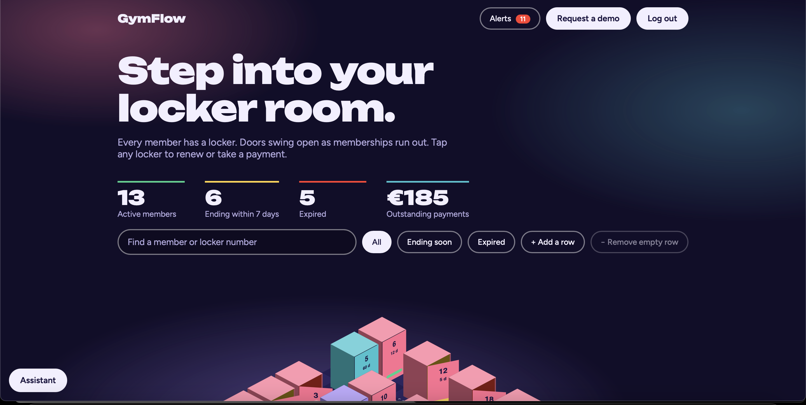
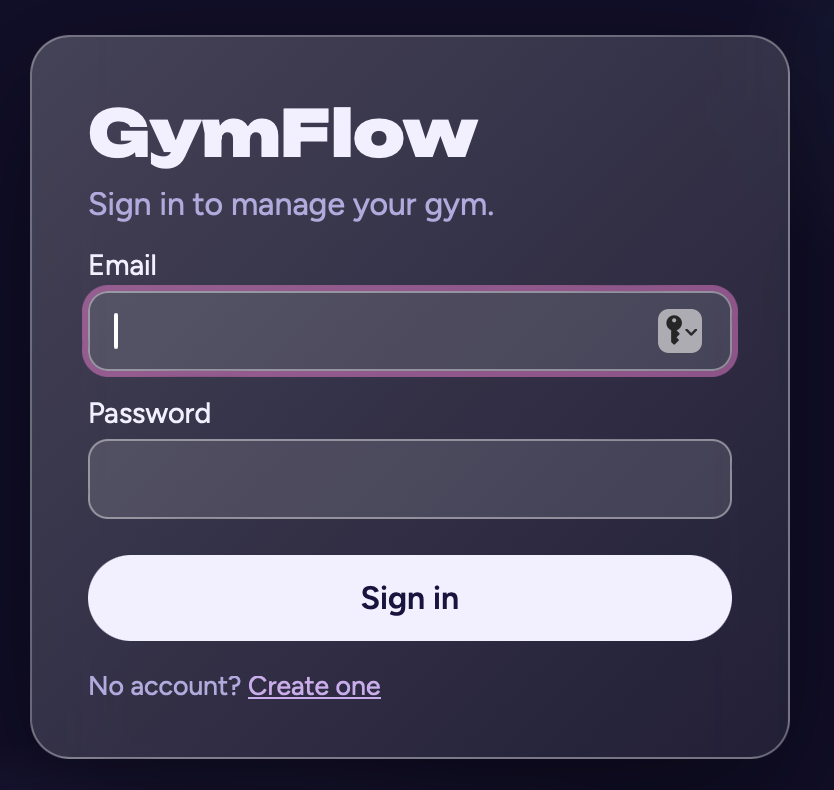
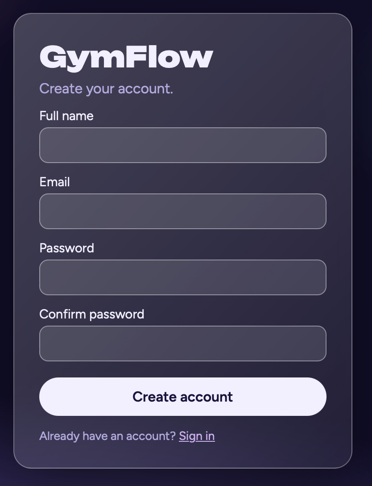
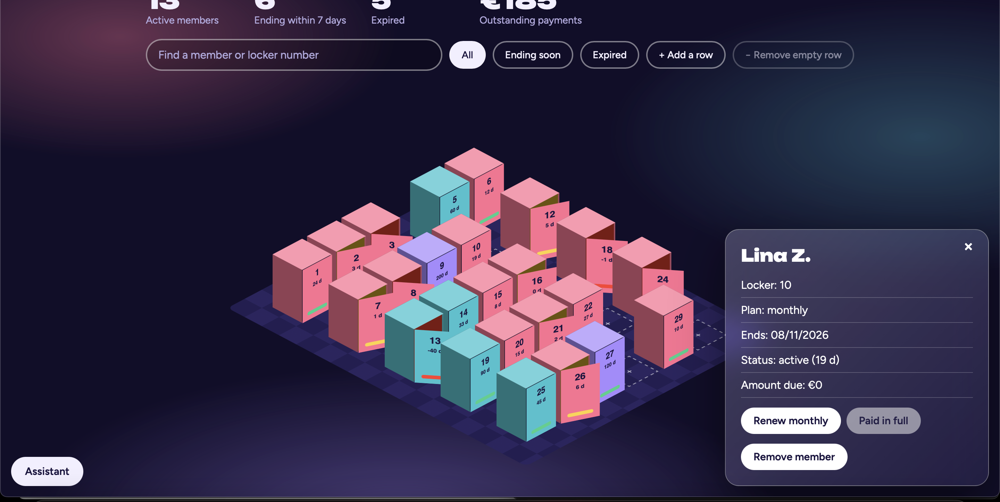
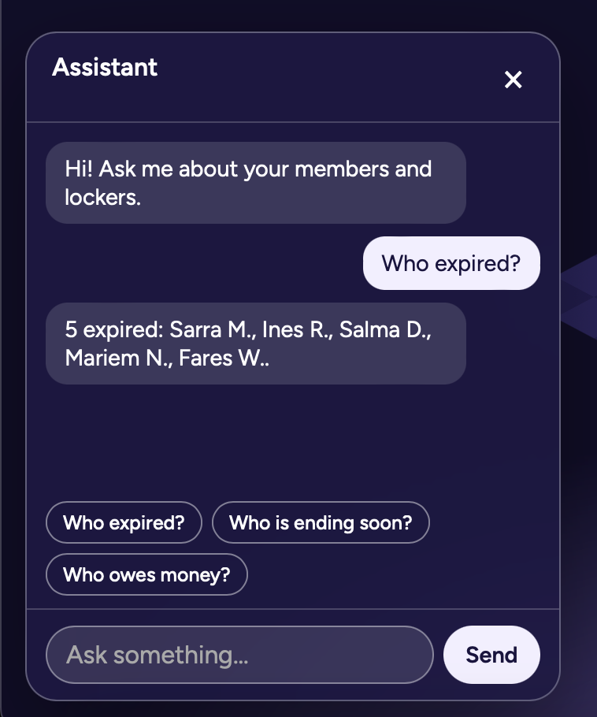

# GymFlow Frontend

A React dashboard for managing gym members, memberships, payments and lockers. Every member gets a locker on an interactive 3D wall: doors swing open as memberships run out.

> Backend repository: **[gymflow-backend](https://github.com/nourhenriahii/gymflow-backend)**



## Features

- Interactive 3D locker wall (drag to rotate, zoom, reset view)
- Locker status at a glance: active, ending within 7 days, expired
- Add members, renew plans (monthly / quarterly / yearly) and record payments
- Alerts bell for memberships that are ending or expired
- Search by name or locker number, and filter by status
- Built-in assistant: "Who expired?", "Who is ending soon?", "Who owes money?"
- Sign up with email verification (6-digit code) and secure login
- Each account has its own private gym data
- Responsive layout

## Screenshots

| Login | Create account |
| --- | --- |
|  |  |

| Member details | Assistant |
| --- | --- |
|  |  |

## Tech stack

- React 19 and Vite
- React Router
- Plain CSS (3D transforms, glassmorphism)

## Getting started

You need Node.js 18+ and the [backend](https://github.com/YOUR-GITHUB/gymflow-backend) running on port 4000.

```bash
git clone https://github.com/YOUR-GITHUB/gymflow-frontend.git
cd gymflow-frontend
npm install
npm run dev
```

Open http://localhost:5173.

In development, Vite forwards every `/api` request to `http://localhost:4000` (see `vite.config.js`), so no extra configuration is needed.

## Scripts

| Command | What it does |
| --- | --- |
| `npm run dev` | Start the dev server |
| `npm run build` | Build for production |
| `npm run preview` | Preview the production build |

## Project structure

```
src/
  components/   LockerWall, Locker, MemberSheet, AddMemberSheet,
                NotificationBell, ChatBot, ProtectedRoute
  pages/        Login, Register, Verify, Dashboard
  utils/        api, auth, getStatus, botAnswer, useEscape
  config.js     Wall size and plan display values
```

## Notes

- Plan names and prices in `src/config.js` are for display only. The server is the source of truth for prices and dates.
- `MAX_LOCKERS` in `src/config.js` must match `MAX_LOCKERS` in the backend `.env`.

## Author

**YOUR NAME**: [GitHub](https://github.com/YOUR-GITHUB) · [LinkedIn](https://www.linkedin.com/in/YOUR-LINKEDIN)
